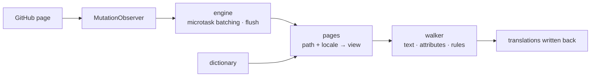

<div align="center">

<h1 id="github-i18n">
  <picture>
    <source media="(prefers-color-scheme: dark)" srcset=".github/assets/wordmark-dark.svg">
    
  </picture>
</h1>

**Localize the GitHub interface into your language — dictionary shipped inside the extension, fully local, zero network requests**

[](https://github.com/Oppenheymu/Github-i18n/actions/workflows/ci.yml)
&emsp;
[](https://bun.sh)
&emsp;

&emsp;
[](./LICENSE)

<p>
  <a href="#features">Features</a> •
  <a href="#installation">Installation</a> •
  <a href="#usage">Usage</a> •
  <a href="#how-it-works">How it works</a> •
  <a href="#development">Development</a> •
  <a href="#documentation">Documentation</a>
</p>

<sub><a href="./README.md">简体中文</a> · <strong>English</strong></sub>

</div>

> [!NOTE]
> **Not affiliated with GitHub.** The name and logo of "GitHub" are trademarks of GitHub, Inc. This project is an independent community localization tool with no affiliation, partnership, or endorsement from GitHub, Inc. See [NOTICE](NOTICE) for details.

---

## Features

- **Built-in dictionary**: translations ship with the extension — nothing is fetched, no online service is called.
- **Loaded per page**: entries are routed by module, page-specific ones override the global fallback, and text that is not covered stays in English.
- **Content untouched**: code blocks, diffs, the editor, READMEs and issue bodies are skipped as whole blocks; only interface text is translated.
- **Zero collection**: no data is collected or uploaded; the developer-mode miss collector is off by default and only writes locally.
- **Follows the SPA**: a `MutationObserver` keeps translating as Turbo navigates, so no refresh is needed.

---

## Installation

The extension targets `github.com` and `gist.github.com`, and is distributed as build-from-source plus sideloading.

```bash
bun install
bun run build
```

1. Open `chrome://extensions` (`edge://extensions` on Edge) and turn on **Developer mode**;
2. Click **Load unpacked** and select `dist/`;
3. Open GitHub and click the toolbar icon to confirm the toggle is on.

> [!TIP]
> After changing code, run `bun run watch` to rebuild, then click **Reload** once on the extensions page; `bun run pack` produces `github-i18n-v<version>.zip`.

---

## Usage

- **Toggle**: turn it off and the whole page reverts to English.
- **Language**: follows the browser by default, and can also be chosen manually. Simplified Chinese is the baseline (100%); 日本語, 繁體中文, 한국어, Español, Français, Deutsch, Português (Brasil / Portugal) and Русский are filled in as they become ready, and untranslated parts stay in English.
- **Developer mode**: off by default; when enabled it only collects missed text on your machine, which you can copy or clear.

---

## How it works

The content script is injected at `document_start`, watches the page with a `MutationObserver`, resolves a dictionary view by "path + locale", and writes the translations back.

<details>
<summary>Show the pipeline</summary>



</details>

---

## Development

```bash
bun run check          # full gate
bun run build          # build dist/
bun run watch          # rebuild on change
bun run pack           # package the zip
bun run report:misses  # miss log → report
```

`bun run check` must be green before committing. The dictionary is 100% original, and **importing dictionaries or code from any GPL / AGPL localization project is strictly forbidden**. Conventions live in [AGENTS.md](./AGENTS.md), the workflow in the [development guide](./docs/guides/development.md).

---

## Documentation

- [Development guide](./docs/guides/development.md)
- [Repository conventions](./AGENTS.md)
- [Security policy](./.github/SECURITY.md)
- [MIT license](./LICENSE) · [Notices](./NOTICE)

---

## Status

[](https://github.com/Oppenheymu/Github-i18n/pulse)

---

## License

Source code and dictionary are both original work, distributed under the [MIT](./LICENSE) license; not affiliated with GitHub, Inc., see [NOTICE](./NOTICE) for details.
