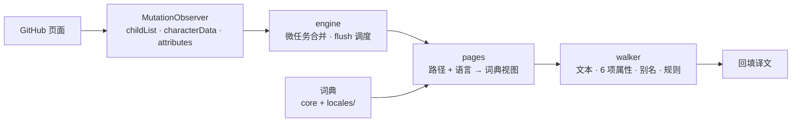

<div align="center">

<h1>
  GitHub<br />
  界面本地化
</h1>

**把 GitHub 界面本地化为你的语言 —— 纯内置词典、完全本地运行、零网络请求**

[](https://github.com/Oppenheymu/Github-i18n/actions/workflows/ci.yml)
&emsp;
[](https://bun.sh)
&emsp;

&emsp;
[](./LICENSE)

<p>
  <a href="#核心特性">核心特性</a> •
  <a href="#安装">安装</a> •
  <a href="#使用">使用</a> •
  <a href="#工作原理">工作原理</a> •
  <a href="#词典">词典</a> •
  <a href="#参与开发">参与开发</a> •
  <a href="#文档与生态">文档</a>
</p>

</div>

> [!NOTE]
> **非官方声明**：\
> 　「GitHub」名称与标识为 GitHub, Inc. 的商标；本项目是独立的社区本地化工具，与 GitHub, Inc. 无任何隶属、合作或背书关系。详见 [NOTICE](NOTICE)。

---

## 核心特性

- **内置词典，离线可用**：\
  5303 条界面词条与 829 条正则规则随扩展一起分发，翻译全程在本地完成；没有网络请求，也不调用任何在线翻译服务。

- **按页面加载，先到先得**：\
  19 个模块按路径路由，只有当前页面的词条参与匹配；具体页压过 `global` 兜底，所以 `Actions` 在仓库页是「操作」、在设置页是「Actions 工作流」。

- **不碰代码与用户内容**：\
  `code` / `pre` / `kbd` / 代码高亮 / diff / 编辑器 / `.markdown-body` 整棵子树跳过，表单控件的 `placeholder` / `aria-label` 仍照常翻译。

- **动态文本用规则**：\
  日期区间、计数、插值句由正则规则现场生成，而不是逐句死记；上游改一句文案，优先补别名或规则，不必重写整句译文。

- **跟随 SPA 无感**：\
  `MutationObserver` 挂在 `document.documentElement` 上，GitHub 的 Turbo 跳转与局部刷新都能接着翻，翻页不用手动刷新。

- **漏翻可自查**：\
  popup 的开发者模式默认关闭，开启后只在本机收集未命中的文本，可一键复制或跑 `bun run report:misses` 生成清单。

---

## 安装

当前以「源码构建 + 侧载」形式分发，仓库不提供商店安装链接；扩展作用于 `github.com` 与 `gist.github.com`。

### 环境要求

- Chrome / Edge（Chromium 内核，支持 Manifest V3）
- [Bun](https://bun.sh) 1.4+（构建与门禁脚本）

### 构建并加载

```bash
bun install
bun run build     # 产出 dist/
```

1. 打开 `chrome://extensions`（Edge 为 `edge://extensions`），开启右上角的「开发者模式」；
2. 点「加载已解压的扩展程序」，选择仓库下的 `dist/` 目录；
3. 打开任意 GitHub 页面，点工具栏图标，确认开关处于开启状态。

需要分发给别人或上传商店时：

```bash
bun run pack      # 生成 github-i18n-v<版本>.zip（store 模式）
```

> [!TIP]
> `dist/` 是构建产物、不入 git。改完代码跑 `bun run watch` 自动重建，再到扩展页点一次「重新加载」。

---

## 使用

点工具栏图标打开 popup：

- **开关**：关闭后整页还原英文；开关与语言切换都会触发一次整页刷新。
- **翻译语言**：可选「自动（跟随浏览器语言）」、简体中文或日本語；未识别的语言回退到简体中文。
- **开发者模式**：默认关闭。开启后收集页面上未命中的文本候选，只存在本机 `chrome.storage.local`，可复制或清空。
- **范围**：只改界面文案；README、代码块、issue 正文等用户内容整块跳过。

---

## 工作原理

content script 以 `run_at: document_start` 注入：先读开关与目标语言，再把 `MutationObserver` 挂到 `document.documentElement`，变更经微任务合并后统一 flush。



- **词典分两层**：语言无关的 `core/` 放路由、规则 `pattern`、别名与规范键；每种语言的 `locales/<id>/` 只放译文。缺键即尚未翻译，保留英文。
- **视图先到先得**：`core/modules.jsonc` 的模块顺序就是优先级，具体页压过 `global`；规则按顺序首条命中生效。
- **排除清单优先**：`code` / `pre` / `textarea` / `.markdown-body` 等命中即跳过整棵子树，宁可少翻也不误伤。
- **不会自激**：已含目标文字的节点跳过、译文不得等于键、同值不写入——三道防线让观察器收敛，页面不会卡死。

---

## 词典

截至 2026-10-23，`bun run check:dict` 的输出：

| 语言 | 覆盖率 | 说明 |
| :--- | :--- | :--- |
| 简体中文 `zh-CN` | **5303 / 5303（100%）** | 19 个模块全部译完 |
| 日本語 `ja` | 4177 / 5303（78.8%） | 还剩 3 个模块待译，未译处保留英文 |

规模：19 个模块 / 5303 条规范键 / 829 条共享规则 / 9480 条译文。数字随词典增长，一律以本机输出为准。

<details>
<summary><b>模块覆盖范围</b></summary>

| 范围 | 模块 |
| :--- | :--- |
| 仓库 | `pages/repo` `pages/issues` `pages/pulls` `pages/commits` `pages/discussions` `pages/wiki` `pages/insights` `pages/actions` `pages/agents` |
| 设置 | `pages/settings` `pages/settings-security` `pages/settings-billing` `pages/repo-settings` `pages/org-settings` |
| 账号与站点 | `pages/profile` `pages/dashboard` `pages/search` `pages/marketing` |
| 全站兜底 | `global` |

</details>

词条按「整节点精确匹配」工作，因此它是一份需要随上游改版持续维护的数据；新增词条的流程见[开发指南](./docs/guides/development.md)。

---

## 隐私

- **零网络请求**：翻译全程在页面内完成，不发起任何网络请求；扩展除 `storage` 权限外，只声明 content script 的站点匹配（`github.com` / `gist.github.com`）。
- **零默认收集**：开发者模式默认关闭，开启前不收集任何文本；收集内容只存在本机，可随时清空。
- **导出前自查**：漏翻清单可能包含仓库名、文件名等页面文本，复制粘贴前请自行检查。

详见 [NOTICE](NOTICE)。

---

## 参与开发

```bash
bun install
bun run check          # 全量门禁：lint + typecheck + 词典 + manifest + 视图快照 + 测试
bun run build          # 构建 dist/
bun run watch          # 监听重建
bun run pack           # dist/ → github-i18n-v<版本>.zip
bun run report:misses  # 开发者模式日志 → 漏翻报告
```

- 提交前 `bun run check` 必须全绿；CI 会在 Linux 上再跑一遍门禁与构建。
- 词典 100% 原创：**严禁引入任何 GPL / AGPL 系汉化项目的词典或代码**；新增词条按[开发指南](./docs/guides/development.md)的流程登记。
- 项目整体 MIT，授权与商标说明见 [NOTICE](NOTICE)。

<details>
<summary><b>仓库结构</b></summary>

| 路径 | 职责 |
| :--- | :--- |
| `src/content/` | 翻译引擎：观察器、调度、TreeWalker、排除判定、漏翻收集 |
| `src/dict/core/` | 语言无关数据：模块路由、规则 pattern、别名、规范键清单 |
| `src/dict/locales/<id>/` | 按语言的译文（zh-CN / ja）与规则模板 |
| `src/popup/` | popup：开关、语言选择、开发者模式面板 |
| `src/shared/` | 词典类型、storage 读写、身份标记 |
| `public/` | manifest、popup.html、`_locales/`、图标（构建时原样拷入） |
| `tooling/` | 构建、打包、门禁与漏翻报告脚本 |
| `docs/` | 开发指南与审计记录 |

</details>

---

## 文档与生态

- **开发指南**：[docs/guides/development.md](./docs/guides/development.md) —— 架构、词典维护流程、漏翻采集与已知边界
- **仓库约定**：[AGENTS.md](./AGENTS.md) —— 硬性约束、门禁说明、提交规范
- **安全策略**：[.github/SECURITY.md](./.github/SECURITY.md)
- **许可与声明**：[LICENSE](./LICENSE) ｜ [NOTICE](./NOTICE)

---

## 状态

[](https://github.com/Oppenheymu/Github-i18n/pulse)

---

## 许可

源码与词典均为原创，以 [MIT](./LICENSE) 分发。本项目与 GitHub, Inc. 无隶属关系，详见 [NOTICE](./NOTICE)。
