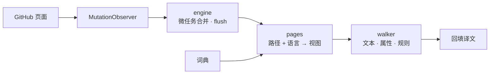

<div align="center">

<h1>Github-i18n</h1>

**把 GitHub 界面本地化为你的语言 —— 纯内置词典、完全本地运行、零网络请求**

[](https://github.com/Oppenheymu/Github-i18n/actions/workflows/ci.yml)
&emsp;
[](https://bun.sh)
&emsp;

&emsp;
[](./LICENSE)

<p>
  <a href="#特性">特性</a> •
  <a href="#安装">安装</a> •
  <a href="#使用">使用</a> •
  <a href="#工作原理">工作原理</a> •
  <a href="#开发">开发</a> •
  <a href="#文档">文档</a>
</p>

</div>

> [!NOTE]
> **非官方声明**：\
> 　「GitHub」名称与标识为 GitHub, Inc. 的商标；本项目是独立的社区本地化工具，与 GitHub, Inc. 无任何隶属、合作或背书关系。详见 [NOTICE](NOTICE)。

---

## 特性

- **内置词典**：词典随扩展分发，翻译不联网、不调用在线服务。
- **按页面加载**：词条按模块路由，具体页压过全局兜底；未收录的文案保留英文。
- **不碰内容**：代码块、diff、编辑器、README 与 issue 正文整块跳过，只翻界面文案。
- **零收集**：不收集、不上传数据；漏翻收集的开发者模式默认关闭，只写本机。
- **跟随 SPA**：`MutationObserver` 跟着 Turbo 跳转继续翻，翻页不用刷新。

---

## 安装

扩展作用于 `github.com` 与 `gist.github.com`，以「源码构建 + 侧载」分发。

```bash
bun install
bun run build
```

1. 打开 `chrome://extensions`（Edge 为 `edge://extensions`），开启「开发者模式」；
2. 点「加载已解压的扩展程序」，选择 `dist/`；
3. 打开 GitHub，点工具栏图标确认开关已开启。

> [!TIP]
> 改完代码跑 `bun run watch` 重建，再到扩展页点一次「重新加载」；`bun run pack` 会打出 `github-i18n-v<版本>.zip`。

---

## 使用

- **开关**：关闭即整页还原英文。
- **语言**：默认跟随浏览器，也可手动选简体中文或日本語。
- **开发者模式**：默认关闭；开启后只在本机收集未命中的文本，可复制或清空。

---

## 工作原理

content script 在 `document_start` 注入，用 `MutationObserver` 捕获页面变化，按「路径 + 语言」取词典视图并回填译文。

<details>
<summary>展开查看管线图</summary>



</details>

---

## 开发

```bash
bun run check          # 全量门禁
bun run build          # 构建 dist/
bun run watch          # 监听重建
bun run pack           # 打包 zip
bun run report:misses  # 漏翻日志 → 报告
```

提交前 `bun run check` 必须全绿。词典 100% 原创，**严禁引入任何 GPL / AGPL 系汉化项目的词典或代码**；约定见 [AGENTS.md](./AGENTS.md)，流程见[开发指南](./docs/guides/development.md)。

---

## 文档

- [开发指南](./docs/guides/development.md)
- [仓库约定](./AGENTS.md)
- [安全策略](./.github/SECURITY.md)
- [许可证 MIT](./LICENSE) ｜ [声明](./NOTICE)

---

## 状态

[](https://github.com/Oppenheymu/Github-i18n/pulse)

---

## 许可

源码与词典均为原创，以 [MIT](./LICENSE) 分发；与 GitHub, Inc. 无隶属关系，详见 [NOTICE](./NOTICE)。
