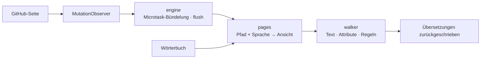

<div align="center">

<h1 id="github-i18n">
  <picture>
    <source media="(prefers-color-scheme: dark)" srcset="../../.github/assets/wordmark-dark.svg">
    
  </picture>
</h1>

**Die GitHub-Oberfläche in deiner Sprache — Wörterbuch im Paket, alles lokal, keine Netzwerkanfragen**

[](https://github.com/Oppenheymu/Github-i18n/actions/workflows/ci.yml)
&emsp;
[](https://bun.sh)
&emsp;

&emsp;
[](../../LICENSE)

<p>
  <a href="#funktionen">Funktionen</a> •
  <a href="#installation">Installation</a> •
  <a href="#verwendung">Verwendung</a> •
  <a href="#funktionsweise">Funktionsweise</a> •
  <a href="#entwicklung">Entwicklung</a> •
  <a href="#dokumentation">Dokumentation</a>
</p>

<sub><a href="../../README.md">English</a> · <a href="./README.zh-CN.md">简体中文</a> · <a href="./README.zh-TW.md">繁體中文</a> · <a href="./README.ja.md">日本語</a> · <a href="./README.ko.md">한국어</a> · <a href="./README.es.md">Español</a> · <a href="./README.fr.md">Français</a> · <strong>Deutsch</strong> · <a href="./README.pt-BR.md">Português (Brasil)</a> · <a href="./README.pt-PT.md">Português (Portugal)</a> · <a href="./README.ru.md">Русский</a></sub>

</div>

> [!NOTE]
> **Nicht offiziell**: Name und Logo „GitHub“ sind Marken von GitHub, Inc. Dieses Projekt ist ein unabhängiges Community-Lokalisierungswerkzeug ohne Verbindung, Partnerschaft oder Billigung durch GitHub, Inc. Details in [NOTICE](../../NOTICE).

---

## Funktionen

- **Integriertes Wörterbuch**: Die Übersetzungen werden mit der Erweiterung ausgeliefert — nichts wird abgerufen, kein Onlinedienst aufgerufen.
- **Pro Seite geladen**: Einträge werden nach Modul geroutet, seitenspezifische haben Vorrang vor dem globalen Fallback, und nicht abgedeckter Text bleibt englisch.
- **Inhalte bleiben unangetastet**: Codeblöcke, Diffs, der Editor, READMEs und Issue-Texte werden als Ganzes übersprungen; übersetzt wird nur die Oberfläche.
- **Keine Erfassung**: Das Store-Paket enthält keinen Sammler; der Entwicklungsbuild (`bun run build`) hat einen optionalen Sammler für verpasste Texte, standardmäßig aus und nur lokal.
- **Folgt der SPA**: Ein `MutationObserver` übersetzt bei der Turbo-Navigation weiter, ohne Neuladen.

---

## Installation

Die Erweiterung wirkt auf `github.com` und `gist.github.com` und wird als „Build aus dem Quellcode + Sideload“ verteilt.

```bash
bun install
bun run build
```

1. `chrome://extensions` öffnen (`edge://extensions` unter Edge) und den **Entwicklermodus** einschalten;
2. Auf **Entpackte Erweiterung laden** klicken und `dist/` auswählen;
3. GitHub öffnen und auf das Symbol in der Symbolleiste klicken, um zu prüfen, ob der Schalter aktiv ist.

> [!TIP]
> Nach Codeänderungen `bun run watch` zum Neubauen ausführen und auf der Erweiterungsseite einmal **Neu laden** klicken; `bun run pack` erzeugt `github-i18n-v<Version>.zip`.

---

## Verwendung

- **Schalter**: ausgeschaltet kehrt die ganze Seite zu Englisch zurück.
- **Sprache**: folgt standardmäßig dem Browser und lässt sich auch manuell wählen. Vereinfachtes Chinesisch (100 %-Basis) und 日本語 sind vollständig übersetzt; die übrigen registrierten Sprachen sind in Arbeit und bleiben im Auswahlfeld verborgen, bis sie fertig sind. Nicht Übersetztes bleibt englisch.
- **Entwicklermodus** (nur Entwicklungsbuilds; in Store-Paketen nicht enthalten): standardmäßig aus; aktiviert sammelt er nur lokal verpassten Text, den du kopieren oder leeren kannst.

---

## Funktionsweise

Das Content-Script wird bei `document_start` injiziert, beobachtet die Seite mit einem `MutationObserver`, ermittelt anhand von „Pfad + Sprache“ eine Wörterbuch-Ansicht und schreibt die Übersetzungen zurück.

<details>
<summary>Pipeline anzeigen</summary>



</details>

---

## Entwicklung

```bash
bun run check          # vollständige Prüfung
bun run build          # dist/ bauen
bun run watch          # bei Änderungen neu bauen
bun run pack           # zip packen
bun run report:misses  # Log verpasster Texte → Bericht
```

Vor dem Commit muss `bun run check` grün sein. Das Wörterbuch ist zu 100 % eigenständig, und **das Einbringen von Wörterbüchern oder Code aus GPL-/AGPL-Lokalisierungsprojekten ist streng verboten**. Konventionen stehen in [AGENTS.md](../../AGENTS.md), der Ablauf im [Entwicklungsleitfaden](../guides/development.md).

---

## Dokumentation

- [Entwicklungsleitfaden](../guides/development.md)
- [Repository-Konventionen](../../AGENTS.md)
- [Sicherheitsrichtlinie](../../.github/SECURITY.md)
- [MIT-Lizenz](../../LICENSE) ｜ [Hinweise](../../NOTICE)

---

## Status

[](https://github.com/Oppenheymu/Github-i18n/pulse)

---

## Lizenz

Quellcode und Wörterbuch sind beides Eigenentwicklungen und stehen unter der [MIT](../../LICENSE)-Lizenz; keine Verbindung zu GitHub, Inc., Details in [NOTICE](../../NOTICE).
