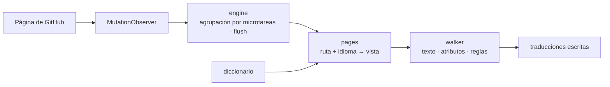

<div align="center">

<h1 id="github-i18n">
  <picture>
    <source media="(prefers-color-scheme: dark)" srcset="../../.github/assets/wordmark-dark.svg">
    
  </picture>
</h1>

**Traduce la interfaz de GitHub a tu idioma — diccionario incluido, todo local, cero peticiones de red**

[](https://github.com/Oppenheymu/Github-i18n/actions/workflows/ci.yml)
&emsp;
[](https://bun.sh)
&emsp;

&emsp;
[](../../LICENSE)

<p>
  <a href="#características">Características</a> •
  <a href="#instalación">Instalación</a> •
  <a href="#uso">Uso</a> •
  <a href="#cómo-funciona">Cómo funciona</a> •
  <a href="#desarrollo">Desarrollo</a> •
  <a href="#documentación">Documentación</a>
</p>

<sub><a href="../../README.md">English</a> · <a href="./README.zh-CN.md">简体中文</a> · <a href="./README.zh-TW.md">繁體中文</a> · <a href="./README.ja.md">日本語</a> · <a href="./README.ko.md">한국어</a> · <strong>Español</strong> · <a href="./README.fr.md">Français</a> · <a href="./README.de.md">Deutsch</a> · <a href="./README.pt-BR.md">Português (Brasil)</a> · <a href="./README.pt-PT.md">Português (Portugal)</a> · <a href="./README.ru.md">Русский</a></sub>

</div>

> [!NOTE]
> **No oficial**: el nombre y el logotipo de «GitHub» son marcas de GitHub, Inc. Este proyecto es una herramienta de localización comunitaria e independiente, sin afiliación, colaboración ni respaldo de GitHub, Inc. Consulta [NOTICE](../../NOTICE) para más detalles.

---

## Características

- **Diccionario incluido**: las traducciones viajan con la extensión; no se descarga nada ni se llama a ningún servicio en línea.
- **Carga por página**: las entradas se enrutan por módulo, las de la página concreta priman sobre el respaldo global y el texto no cubierto se queda en inglés.
- **Sin tocar el contenido**: los bloques de código, los diffs, el editor, los README y los cuerpos de los issues se omiten por completo; solo se traduce el texto de la interfaz.
- **Cero recogida**: no se recogen ni se suben datos; el recopilador de fallos del modo desarrollador está desactivado por defecto y solo escribe en local.
- **Sigue la SPA**: un `MutationObserver` sigue traduciendo mientras Turbo navega, así que no hace falta recargar.

---

## Instalación

La extensión funciona en `github.com` y `gist.github.com`, y se distribuye como «compilar desde el código fuente + carga manual».

```bash
bun install
bun run build
```

1. Abre `chrome://extensions` (`edge://extensions` en Edge) y activa el **modo de desarrollador**;
2. Pulsa **Cargar descomprimida** y selecciona `dist/`;
3. Abre GitHub y pulsa el icono de la barra de herramientas para comprobar que el interruptor está activado.

> [!TIP]
> Después de cambiar el código, ejecuta `bun run watch` para recompilar y pulsa **Recargar** una vez en la página de extensiones; `bun run pack` genera `github-i18n-v<versión>.zip`.

---

## Uso

- **Interruptor**: si lo desactivas, toda la página vuelve al inglés.
- **Idioma**: sigue el navegador por defecto y también se puede elegir a mano. El chino simplificado es la base (100 %); 日本語, 繁體中文, 한국어, Español, Français, Deutsch, Português (Brasil / Portugal) y Русский se van completando según estén listos, y lo no traducido se queda en inglés.
- **Modo desarrollador**: desactivado por defecto; al activarlo solo recoge en tu equipo el texto no traducido, que puedes copiar o borrar.

---

## Cómo funciona

El content script se inyecta en `document_start`, observa la página con un `MutationObserver`, resuelve una vista del diccionario según «ruta + idioma» y escribe las traducciones.

<details>
<summary>Ver el flujo</summary>



</details>

---

## Desarrollo

```bash
bun run check          # comprobación completa
bun run build          # compilar dist/
bun run watch          # recompilar al cambiar
bun run pack           # empaquetar el zip
bun run report:misses  # registro de fallos → informe
```

`bun run check` debe estar en verde antes de hacer commit. El diccionario es 100 % original y **está terminantemente prohibido importar diccionarios o código de cualquier proyecto de localización con licencia GPL / AGPL**. Las convenciones están en [AGENTS.md](../../AGENTS.md) y el flujo de trabajo en la [guía de desarrollo](../guides/development.md).

---

## Documentación

- [Guía de desarrollo](../guides/development.md)
- [Convenciones del repositorio](../../AGENTS.md)
- [Política de seguridad](../../.github/SECURITY.md)
- [Licencia MIT](../../LICENSE) ｜ [Avisos](../../NOTICE)

---

## Estado

[](https://github.com/Oppenheymu/Github-i18n/pulse)

---

## Licencia

Tanto el código como el diccionario son originales y se distribuyen bajo la licencia [MIT](../../LICENSE); no tenemos relación con GitHub, Inc., consulta [NOTICE](../../NOTICE) para más detalles.
