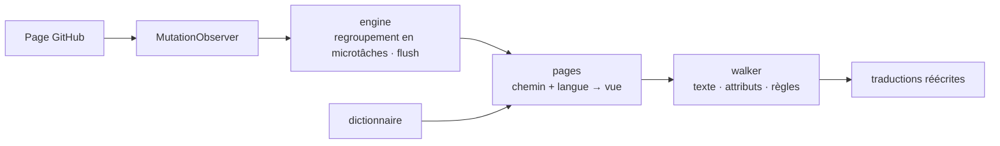

<div align="center">

<h1 id="github-i18n">
  <picture>
    <source media="(prefers-color-scheme: dark)" srcset="../../.github/assets/wordmark-dark.svg">
    
  </picture>
</h1>

**Localisez l'interface de GitHub dans votre langue — dictionnaire embarqué, 100 % local, aucune requête réseau**

[](https://github.com/Oppenheymu/Github-i18n/actions/workflows/ci.yml)
&emsp;
[](https://bun.sh)
&emsp;

&emsp;
[](../../LICENSE)

<p>
  <a href="#fonctionnalités">Fonctionnalités</a> •
  <a href="#installation">Installation</a> •
  <a href="#utilisation">Utilisation</a> •
  <a href="#fonctionnement">Fonctionnement</a> •
  <a href="#développement">Développement</a> •
  <a href="#documentation">Documentation</a>
</p>

<sub><a href="../../README.md">English</a> · <a href="./README.zh-CN.md">简体中文</a> · <a href="./README.zh-TW.md">繁體中文</a> · <a href="./README.ja.md">日本語</a> · <a href="./README.ko.md">한국어</a> · <a href="./README.es.md">Español</a> · <strong>Français</strong> · <a href="./README.de.md">Deutsch</a> · <a href="./README.pt-BR.md">Português (Brasil)</a> · <a href="./README.pt-PT.md">Português (Portugal)</a> · <a href="./README.ru.md">Русский</a></sub>

</div>

> [!NOTE]
> **Non officiel** : le nom et le logo « GitHub » sont des marques de GitHub, Inc. Ce projet est un outil de localisation communautaire indépendant, sans affiliation, partenariat ni approbation de GitHub, Inc. Voir [NOTICE](../../NOTICE) pour les détails.

---

## Fonctionnalités

- **Dictionnaire embarqué** : les traductions sont livrées avec l'extension ; rien n'est téléchargé, aucun service en ligne n'est appelé.
- **Chargement par page** : les entrées sont routées par module, celles de la page priment sur le repli global, et le texte non couvert reste en anglais.
- **Contenu préservé** : les blocs de code, les diffs, l'éditeur, les README et le corps des issues sont ignorés en bloc ; seul le texte de l'interface est traduit.
- **Zéro collecte** : aucune donnée n'est collectée ni envoyée ; le collecteur de ratés du mode développeur est désactivé par défaut et n'écrit qu'en local.
- **Suit la SPA** : un `MutationObserver` continue de traduire pendant la navigation Turbo, sans rechargement.

---

## Installation

L'extension cible `github.com` et `gist.github.com`, et se distribue en « compilation depuis les sources + chargement manuel ».

```bash
bun install
bun run build
```

1. Ouvrez `chrome://extensions` (`edge://extensions` sur Edge) et activez le **mode développeur** ;
2. Cliquez sur **Charger l'extension non empaquetée** et sélectionnez `dist/` ;
3. Ouvrez GitHub et cliquez sur l'icône de la barre d'outils pour vérifier que l'interrupteur est activé.

> [!TIP]
> Après une modification, lancez `bun run watch` pour reconstruire, puis cliquez une fois sur **Actualiser** dans la page des extensions ; `bun run pack` produit `github-i18n-v<version>.zip`.

---

## Utilisation

- **Interrupteur** : désactivé, toute la page repasse en anglais.
- **Langue** : suit le navigateur par défaut et peut aussi être choisie manuellement. Le chinois simplifié est la base (100 %) ; 日本語, 繁體中文, 한국어, Español, Français, Deutsch, Português (Brasil / Portugal) et Русский sont complétés au fur et à mesure, et ce qui n'est pas traduit reste en anglais.
- **Mode développeur** : désactivé par défaut ; une fois activé, il ne collecte en local que le texte non traduit, que vous pouvez copier ou effacer.

---

## Fonctionnement

Le content script est injecté à `document_start`, observe la page avec un `MutationObserver`, résout une vue du dictionnaire selon « chemin + langue » et réécrit les traductions.

<details>
<summary>Voir le pipeline</summary>



</details>

---

## Développement

```bash
bun run check          # vérification complète
bun run build          # compiler dist/
bun run watch          # reconstruire à chaque modification
bun run pack           # créer le zip
bun run report:misses  # journal des ratés → rapport
```

`bun run check` doit être au vert avant tout commit. Le dictionnaire est 100 % original et **importer des dictionnaires ou du code de tout projet de localisation sous GPL / AGPL est strictement interdit**. Les conventions sont dans [AGENTS.md](../../AGENTS.md), le processus dans le [guide de développement](../guides/development.md).

---

## Documentation

- [Guide de développement](../guides/development.md)
- [Conventions du dépôt](../../AGENTS.md)
- [Politique de sécurité](../../.github/SECURITY.md)
- [Licence MIT](../../LICENSE) ｜ [Mentions](../../NOTICE)

---

## État

[](https://github.com/Oppenheymu/Github-i18n/pulse)

---

## Licence

Le code source et le dictionnaire sont tous deux originaux, distribués sous licence [MIT](../../LICENSE) ; aucun lien avec GitHub, Inc., voir [NOTICE](../../NOTICE) pour les détails.
