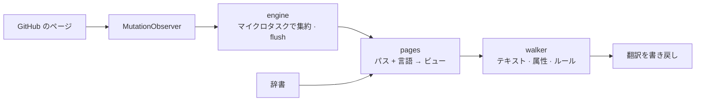

<div align="center">

<h1 id="github-i18n">
  <picture>
    <source media="(prefers-color-scheme: dark)" srcset="../../.github/assets/wordmark-dark.svg">
    
  </picture>
</h1>

**GitHub のインターフェースをあなたの言語に —— 辞書は同梱、すべてローカル実行、ネットワークリクエストはゼロ**

[](https://github.com/Oppenheymu/Github-i18n/actions/workflows/ci.yml)
&emsp;
[](https://bun.sh)
&emsp;

&emsp;
[](../../LICENSE)

<p>
  <a href="#機能">機能</a> •
  <a href="#インストール">インストール</a> •
  <a href="#使い方">使い方</a> •
  <a href="#仕組み">仕組み</a> •
  <a href="#開発">開発</a> •
  <a href="#ドキュメント">ドキュメント</a>
</p>

<sub><a href="../../README.md">English</a> · <a href="./README.zh-CN.md">简体中文</a> · <a href="./README.zh-TW.md">繁體中文</a> · <strong>日本語</strong> · <a href="./README.ko.md">한국어</a> · <a href="./README.es.md">Español</a> · <a href="./README.fr.md">Français</a> · <a href="./README.de.md">Deutsch</a> · <a href="./README.pt-BR.md">Português (Brasil)</a> · <a href="./README.pt-PT.md">Português (Portugal)</a> · <a href="./README.ru.md">Русский</a></sub>

</div>

> [!NOTE]
> **非公式**：名称とロゴ「GitHub」は GitHub, Inc. の商標です。本プロジェクトは独立したコミュニティ製のローカライズツールであり、GitHub, Inc. との提携・協力・承認関係は一切ありません。詳細は [NOTICE](../../NOTICE) を参照してください。

---

## 機能

- **同梱の辞書**：翻訳は拡張機能に同梱されており、通信もオンラインサービスの呼び出しもしません。
- **ページ単位で読み込み**：項目はモジュールごとに振り分けられ、ページ固有のものがグローバルなフォールバックより優先されます。未収録の文言は英語のまま残ります。
- **コンテンツには触れない**：コードブロック、diff、エディタ、README や issue 本文はブロックごとスキップし、UI の文言だけを翻訳します。
- **収集ゼロ**：ストア版には収集機能がありません。開発ビルド（`bun run build`）には任意の翻訳漏れコレクターがあり、既定はオフでローカルに書き込むだけです。
- **SPA に追従**：`MutationObserver` が Turbo の遷移に追従して翻訳を続けるので、再読み込みは不要です。

---

## インストール

この拡張機能は `github.com` と `gist.github.com` で動作し、「ソースからビルド + サイドロード」で配布します。

```bash
bun install
bun run build
```

1. `chrome://extensions`（Edge は `edge://extensions`）を開き、「デベロッパーモード」をオンにします。
2. 「パッケージ化されていない拡張機能を読み込む」をクリックし、`dist/` を選択します。
3. GitHub を開き、ツールバーのアイコンをクリックしてスイッチがオンになっていることを確認します。

> [!TIP]
> コードを変更したら `bun run watch` で再ビルドし、拡張機能ページで一度「再読み込み」をクリックします。`bun run pack` は `github-i18n-v<バージョン>.zip` を出力します。

---

## 使い方

- **スイッチ**：オフにするとページ全体が英語に戻ります。
- **言語**：既定ではブラウザに従い、手動でも選択できます。簡体字中国語（100% のベースライン）と日本語は全訳済みです。その他の登録言語は準備中で、完成するまで選択器には表示されません。未翻訳の部分は英語のままです。
- **開発者モード**（開発ビルドのみ。ストア版には含まれません）：既定はオフ。オンにすると一致しなかったテキストをローカルに収集するだけで、コピーやクリアができます。

---

## 仕組み

content script は `document_start` で注入され、`MutationObserver` でページの変化を監視し、「パス + 言語」で辞書ビューを取得して翻訳を書き戻します。

<details>
<summary>パイプラインを表示</summary>



</details>

---

## 開発

```bash
bun run check          # 全体チェック
bun run build          # dist/ をビルド
bun run watch          # 変更を監視して再ビルド
bun run pack           # zip を作成
bun run report:misses  # 翻訳漏れログ → レポート
```

コミット前に `bun run check` がすべて通っている必要があります。辞書は 100% オリジナルで、**GPL / AGPL 系のローカライズプロジェクトの辞書やコードを持ち込むことは固く禁じます**。規約は [AGENTS.md](../../AGENTS.md)、手順は[開発ガイド](../guides/development.md)を参照してください。

---

## ドキュメント

- [開発ガイド](../guides/development.md)
- [リポジトリの規約](../../AGENTS.md)
- [セキュリティポリシー](../../.github/SECURITY.md)
- [MIT ライセンス](../../LICENSE) ｜ [表記](../../NOTICE)

---

## ステータス

[](https://github.com/Oppenheymu/Github-i18n/pulse)

---

## ライセンス

ソースコードと辞書はいずれもオリジナルで、[MIT](../../LICENSE) ライセンスで配布しています。GitHub, Inc. とは無関係です。詳細は [NOTICE](../../NOTICE) を参照してください。
