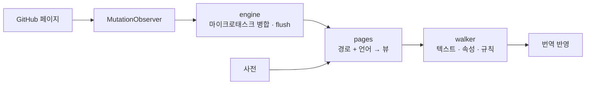

<div align="center">

<h1 id="github-i18n">
  <picture>
    <source media="(prefers-color-scheme: dark)" srcset="../../.github/assets/wordmark-dark.svg">
    
  </picture>
</h1>

**GitHub 인터페이스를 당신의 언어로 — 사전 내장, 전부 로컬 실행, 네트워크 요청 없음**

[](https://github.com/Oppenheymu/Github-i18n/actions/workflows/ci.yml)
&emsp;
[](https://bun.sh)
&emsp;

&emsp;
[](../../LICENSE)

<p>
  <a href="#기능">기능</a> •
  <a href="#설치">설치</a> •
  <a href="#사용법">사용법</a> •
  <a href="#동작-원리">동작 원리</a> •
  <a href="#개발">개발</a> •
  <a href="#문서">문서</a>
</p>

<sub><a href="../../README.md">English</a> · <a href="./README.zh-CN.md">简体中文</a> · <a href="./README.zh-TW.md">繁體中文</a> · <a href="./README.ja.md">日本語</a> · <strong>한국어</strong> · <a href="./README.es.md">Español</a> · <a href="./README.fr.md">Français</a> · <a href="./README.de.md">Deutsch</a> · <a href="./README.pt-BR.md">Português (Brasil)</a> · <a href="./README.pt-PT.md">Português (Portugal)</a> · <a href="./README.ru.md">Русский</a></sub>

</div>

> [!NOTE]
> **비공식**: "GitHub" 명칭과 로고는 GitHub, Inc.의 상표입니다. 이 프로젝트는 독립적인 커뮤니티 현지화 도구이며 GitHub, Inc.와 제휴, 협력, 보증 관계가 없습니다. 자세한 내용은 [NOTICE](../../NOTICE)를 참고하세요.

---

## 기능

- **내장 사전**: 번역이 확장 프로그램에 포함되어 있어 아무것도 가져오지 않고 온라인 서비스도 호출하지 않습니다.
- **페이지 단위 로딩**: 항목은 모듈별로 라우팅되며, 페이지 전용 항목이 전역 폴백보다 우선합니다. 수록되지 않은 문구는 영어로 남습니다.
- **콘텐츠는 건드리지 않음**: 코드 블록, diff, 편집기, README와 이슈 본문은 통째로 건너뛰고 인터페이스 문구만 번역합니다.
- **수집 없음**: 데이터를 수집하거나 업로드하지 않습니다. 누락 수집은 개발자 모드에서 기본적으로 꺼져 있고 로컬에만 기록합니다.
- **SPA 추적**: `MutationObserver`가 Turbo 탐색을 따라 계속 번역하므로 새로고침이 필요 없습니다.

---

## 설치

이 확장 프로그램은 `github.com`과 `gist.github.com`에서 동작하며, "소스에서 빌드 + 사이드로드" 방식으로 배포됩니다.

```bash
bun install
bun run build
```

1. `chrome://extensions`(Edge는 `edge://extensions`)를 열고 **개발자 모드**를 켭니다.
2. **압축해제된 확장 프로그램을 로드합니다**를 클릭하고 `dist/`를 선택합니다.
3. GitHub를 열고 도구 모음 아이콘을 클릭해 스위치가 켜져 있는지 확인합니다.

> [!TIP]
> 코드를 수정한 뒤 `bun run watch`로 다시 빌드하고, 확장 프로그램 페이지에서 **새로고침**을 한 번 클릭하세요. `bun run pack`은 `github-i18n-v<버전>.zip`을 만듭니다.

---

## 사용법

- **스위치**: 끄면 페이지 전체가 영어로 돌아갑니다.
- **언어**: 기본적으로 브라우저를 따르며 직접 선택할 수도 있습니다. 중국어 간체가 기준(100%)이고, 日本語, 繁體中文, 한국어, Español, Français, Deutsch, Português (Brasil / Portugal), Русский는 준비되는 대로 채워지며 번역되지 않은 부분은 영어로 남습니다.
- **개발자 모드**: 기본적으로 꺼져 있으며, 켜면 일치하지 않은 텍스트를 로컬에만 수집하고 복사하거나 비울 수 있습니다.

---

## 동작 원리

content script는 `document_start`에 주입되어 `MutationObserver`로 페이지 변화를 감시하고, "경로 + 언어"로 사전 뷰를 가져와 번역을 다시 씁니다.

<details>
<summary>파이프라인 보기</summary>



</details>

---

## 개발

```bash
bun run check          # 전체 검사
bun run build          # dist/ 빌드
bun run watch          # 변경 감지 후 재빌드
bun run pack           # zip 패키징
bun run report:misses  # 누락 로그 → 보고서
```

커밋 전에 `bun run check`가 모두 통과해야 합니다. 사전은 100% 자체 제작이며, **GPL / AGPL 계열 현지화 프로젝트의 사전이나 코드를 가져오는 것은 엄격히 금지됩니다**. 규약은 [AGENTS.md](../../AGENTS.md), 절차는 [개발 가이드](../guides/development.md)를 참고하세요.

---

## 문서

- [개발 가이드](../guides/development.md)
- [저장소 규약](../../AGENTS.md)
- [보안 정책](../../.github/SECURITY.md)
- [MIT 라이선스](../../LICENSE) ｜ [고지](../../NOTICE)

---

## 현황

[](https://github.com/Oppenheymu/Github-i18n/pulse)

---

## 라이선스

소스 코드와 사전은 모두 자체 제작이며 [MIT](../../LICENSE) 라이선스로 배포됩니다. GitHub, Inc.와 무관하며 자세한 내용은 [NOTICE](../../NOTICE)를 참고하세요.
