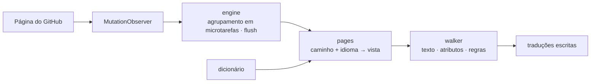

<div align="center">

<h1 id="github-i18n">
  <picture>
    <source media="(prefers-color-scheme: dark)" srcset="../../.github/assets/wordmark-dark.svg">
    
  </picture>
</h1>

**Traduza a interface do GitHub para o seu idioma — dicionário incluído, tudo local, zero pedidos de rede**

[](https://github.com/Oppenheymu/Github-i18n/actions/workflows/ci.yml)
&emsp;
[](https://bun.sh)
&emsp;

&emsp;
[](../../LICENSE)

<p>
  <a href="#funcionalidades">Funcionalidades</a> •
  <a href="#instalação">Instalação</a> •
  <a href="#utilização">Utilização</a> •
  <a href="#como-funciona">Como funciona</a> •
  <a href="#desenvolvimento">Desenvolvimento</a> •
  <a href="#documentação">Documentação</a>
</p>

<sub><a href="../../README.md">English</a> · <a href="./README.zh-CN.md">简体中文</a> · <a href="./README.zh-TW.md">繁體中文</a> · <a href="./README.ja.md">日本語</a> · <a href="./README.ko.md">한국어</a> · <a href="./README.es.md">Español</a> · <a href="./README.fr.md">Français</a> · <a href="./README.de.md">Deutsch</a> · <a href="./README.pt-BR.md">Português (Brasil)</a> · <strong>Português (Portugal)</strong> · <a href="./README.ru.md">Русский</a></sub>

</div>

> [!NOTE]
> **Não oficial**: o nome e o logótipo «GitHub» são marcas da GitHub, Inc. Este projeto é uma ferramenta independente de localização da comunidade, sem afiliação, parceria ou aprovação da GitHub, Inc. Consulte [NOTICE](../../NOTICE) para mais detalhes.

---

## Funcionalidades

- **Dicionário incluído**: as traduções são distribuídas com a extensão — nada é transferido e nenhum serviço online é chamado.
- **Carregamento por página**: as entradas são encaminhadas por módulo, as da página específica têm prioridade sobre o fallback global, e o texto não abrangido mantém-se em inglês.
- **Conteúdo intacto**: blocos de código, diffs, o editor, READMEs e corpos de issues são ignorados por inteiro; só o texto da interface é traduzido.
- **Zero recolha**: nenhum dado é recolhido ou enviado; o recoletor de falhas do modo de programador vem desligado por omissão e grava apenas localmente.
- **Acompanha a SPA**: um `MutationObserver` continua a traduzir durante a navegação do Turbo, sem ser preciso recarregar.

---

## Instalação

A extensão atua em `github.com` e `gist.github.com` e é distribuída como «compilar a partir do código-fonte + carregamento manual».

```bash
bun install
bun run build
```

1. Abra `chrome://extensions` (`edge://extensions` no Edge) e ative o **modo de programador**;
2. Clique em **Carregar extensão descompactada** e escolha `dist/`;
3. Abra o GitHub e clique no ícone da barra de ferramentas para confirmar que o interruptor está ligado.

> [!TIP]
> Depois de alterar o código, execute `bun run watch` para recompilar e clique em **Recarregar** uma vez na página de extensões; `bun run pack` gera `github-i18n-v<versão>.zip`.

---

## Utilização

- **Interruptor**: desligado, a página inteira volta ao inglês.
- **Idioma**: segue o navegador por omissão e também pode ser escolhido manualmente. O chinês simplificado é a base (100%); 日本語, 繁體中文, 한국어, Español, Français, Deutsch, Português (Brasil / Portugal) e Русский vão sendo preenchidos à medida que ficam prontos, e o que não está traduzido mantém-se em inglês.
- **Modo de programador**: desligado por omissão; quando ligado, recolhe apenas no seu computador o texto não traduzido, que pode copiar ou limpar.

---

## Como funciona

O content script é injetado em `document_start`, observa a página com um `MutationObserver`, resolve uma vista do dicionário por «caminho + idioma» e escreve as traduções de volta.

<details>
<summary>Ver o fluxo</summary>



</details>

---

## Desenvolvimento

```bash
bun run check          # verificação completa
bun run build          # compilar dist/
bun run watch          # recompilar ao alterar
bun run pack           # empacotar o zip
bun run report:misses  # registo de falhas → relatório
```

O `bun run check` tem de estar verde antes do commit. O dicionário é 100 % original e **é terminantemente proibido importar dicionários ou código de qualquer projeto de localização sob GPL / AGPL**. As convenções estão em [AGENTS.md](../../AGENTS.md) e o fluxo no [guia de desenvolvimento](../guides/development.md).

---

## Documentação

- [Guia de desenvolvimento](../guides/development.md)
- [Convenções do repositório](../../AGENTS.md)
- [Política de segurança](../../.github/SECURITY.md)
- [Licença MIT](../../LICENSE) ｜ [Avisos](../../NOTICE)

---

## Estado

[](https://github.com/Oppenheymu/Github-i18n/pulse)

---

## Licença

O código-fonte e o dicionário são originais e distribuídos sob a licença [MIT](../../LICENSE); sem qualquer vínculo com a GitHub, Inc., consulte [NOTICE](../../NOTICE) para mais detalhes.
