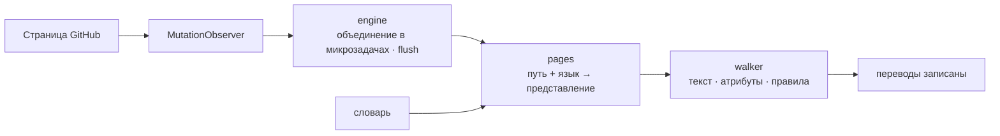

<div align="center">

<h1 id="github-i18n">
  <picture>
    <source media="(prefers-color-scheme: dark)" srcset="../../.github/assets/wordmark-dark.svg">
    
  </picture>
</h1>

**Локализуйте интерфейс GitHub на свой язык — словарь в комплекте, всё локально, без сетевых запросов**

[](https://github.com/Oppenheymu/Github-i18n/actions/workflows/ci.yml)
&emsp;
[](https://bun.sh)
&emsp;

&emsp;
[](../../LICENSE)

<p>
  <a href="#возможности">Возможности</a> •
  <a href="#установка">Установка</a> •
  <a href="#использование">Использование</a> •
  <a href="#как-это-работает">Как это работает</a> •
  <a href="#разработка">Разработка</a> •
  <a href="#документация">Документация</a>
</p>

<sub><a href="../../README.md">English</a> · <a href="./README.zh-CN.md">简体中文</a> · <a href="./README.zh-TW.md">繁體中文</a> · <a href="./README.ja.md">日本語</a> · <a href="./README.ko.md">한국어</a> · <a href="./README.es.md">Español</a> · <a href="./README.fr.md">Français</a> · <a href="./README.de.md">Deutsch</a> · <a href="./README.pt-BR.md">Português (Brasil)</a> · <a href="./README.pt-PT.md">Português (Portugal)</a> · <strong>Русский</strong></sub>

</div>

> [!NOTE]
> **Неофициальный проект**: название и логотип «GitHub» являются товарными знаками GitHub, Inc. Этот проект — независимый инструмент локализации сообщества, не связанный с GitHub, Inc. и не имеющий её одобрения. Подробности в [NOTICE](../../NOTICE).

---

## Возможности

- **Встроенный словарь**: переводы поставляются вместе с расширением — ничего не загружается и никакие онлайн-сервисы не вызываются.
- **Загрузка по страницам**: записи распределяются по модулям, записи конкретной страницы важнее глобального резерва, а непокрытый текст остаётся на английском.
- **Контент не трогаем**: блоки кода, диффы, редактор, README и тела issues пропускаются целиком, переводится только текст интерфейса.
- **Ноль сбора**: в магазинном пакете нет сборщика; в dev-сборке (`bun run build`) есть необязательный сборщик пропусков, по умолчанию выключенный и работающий только локально.
- **Следит за SPA**: `MutationObserver` продолжает переводить при навигации Turbo, перезагрузка не нужна.

---

## Установка

Расширение работает на `github.com` и `gist.github.com` и распространяется как «сборка из исходников + ручная установка».

```bash
bun install
bun run build
```

1. Откройте `chrome://extensions` (в Edge — `edge://extensions`) и включите **режим разработчика**;
2. Нажмите **Загрузить распакованное расширение** и выберите `dist/`;
3. Откройте GitHub и нажмите на значок на панели инструментов, чтобы убедиться, что переключатель включён.

> [!TIP]
> После правок запустите `bun run watch` для пересборки и нажмите **Обновить** на странице расширений один раз; `bun run pack` создаст `github-i18n-v<версия>.zip`.

---

## Использование

- **Переключатель**: выключите — вся страница вернётся к английскому.
- **Язык**: по умолчанию берётся из браузера, но его можно выбрать вручную. Упрощённый китайский (база 100 %) и японский переведены полностью; остальные зарегистрированные языки в подготовке и не показываются в списке до готовности. Непереведённые части остаются на английском.
- **Режим разработчика** (только dev-сборки; в пакетах магазина отсутствует): по умолчанию выключен; включённый, он собирает непереведённый текст только на вашем компьютере, его можно скопировать или очистить.

---

## Как это работает

Content script внедряется на `document_start`, следит за страницей через `MutationObserver`, получает представление словаря по «пути + языку» и записывает переводы обратно.

<details>
<summary>Показать конвейер</summary>



</details>

---

## Разработка

```bash
bun run check          # полная проверка
bun run build          # сборка dist/
bun run watch          # пересборка при изменениях
bun run pack           # упаковка zip
bun run report:misses  # журнал пропусков → отчёт
```

Перед коммитом `bun run check` должен быть зелёным. Словарь на 100 % оригинальный, и **импортировать словари или код из любых проектов локализации под GPL / AGPL строго запрещено**. Соглашения — в [AGENTS.md](../../AGENTS.md), процесс — в [руководстве по разработке](../guides/development.md).

---

## Документация

- [Руководство по разработке](../guides/development.md)
- [Соглашения репозитория](../../AGENTS.md)
- [Политика безопасности](../../.github/SECURITY.md)
- [Лицензия MIT](../../LICENSE) ｜ [Уведомления](../../NOTICE)

---

## Статус

[](https://github.com/Oppenheymu/Github-i18n/pulse)

---

## Лицензия

Исходный код и словарь оригинальны и распространяются по лицензии [MIT](../../LICENSE); проект не связан с GitHub, Inc., подробности в [NOTICE](../../NOTICE).
