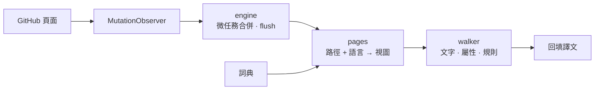

<div align="center">

<h1 id="github-i18n">
  <picture>
    <source media="(prefers-color-scheme: dark)" srcset="../../.github/assets/wordmark-dark.svg">
    
  </picture>
</h1>

**將 GitHub 介面在地化為你的語言 —— 純內建詞典、完全在本機執行、零網路請求**

[](https://github.com/Oppenheymu/Github-i18n/actions/workflows/ci.yml)
&emsp;
[](https://bun.sh)
&emsp;

&emsp;
[](../../LICENSE)

<p>
  <a href="#功能">功能</a> •
  <a href="#安裝">安裝</a> •
  <a href="#使用">使用</a> •
  <a href="#運作原理">運作原理</a> •
  <a href="#開發">開發</a> •
  <a href="#文件">文件</a>
</p>

<sub><a href="../../README.md">English</a> · <a href="./README.zh-CN.md">简体中文</a> · <strong>繁體中文</strong> · <a href="./README.ja.md">日本語</a> · <a href="./README.ko.md">한국어</a> · <a href="./README.es.md">Español</a> · <a href="./README.fr.md">Français</a> · <a href="./README.de.md">Deutsch</a> · <a href="./README.pt-BR.md">Português (Brasil)</a> · <a href="./README.pt-PT.md">Português (Portugal)</a> · <a href="./README.ru.md">Русский</a></sub>

</div>

> [!NOTE]
> **非官方聲明**：\
> 　「GitHub」名稱與標識為 GitHub, Inc. 的商標；本專案是獨立的社群在地化工具，與 GitHub, Inc. 無任何隸屬、合作或背書關係。詳見 [NOTICE](../../NOTICE)。

---

## 功能

- **內建詞典**：詞典隨擴充功能一起散布，翻譯不連網、不呼叫線上服務。
- **依頁面載入**：詞條依模組路由，具體頁面優先於全域兜底；未收錄的文案保留英文。
- **不碰內容**：程式碼區塊、diff、編輯器、README 與 issue 內文整塊跳過，只翻譯介面文案。
- **零收集**：商店包不含任何收集器；開發建置（`bun run build`）保留一個可選的漏翻收集器，預設關閉、只寫本機。
- **跟隨 SPA**：`MutationObserver` 跟著 Turbo 跳轉繼續翻譯，換頁不用重新整理。

---

## 安裝

擴充功能作用於 `github.com` 與 `gist.github.com`，以「原始碼建置 + 側載」散布。

```bash
bun install
bun run build
```

1. 開啟 `chrome://extensions`（Edge 為 `edge://extensions`），開啟「開發人員模式」；
2. 點「載入未封裝項目」，選擇 `dist/`；
3. 開啟 GitHub，點工具列圖示確認開關已開啟。

> [!TIP]
> 改完程式碼執行 `bun run watch` 重建，再到擴充功能頁點一次「重新載入」；`bun run pack` 會產出 `github-i18n-v<版本>.zip`。

---

## 使用

- **開關**：關閉即整頁還原英文。
- **語言**：預設跟隨瀏覽器，也可手動選擇。簡體中文（100% 基線）與日本語已完整譯完；其餘已登記語言仍在籌備，譯完前不會出現在選擇器裡。未譯部分保留英文。
- **開發人員模式**（僅開發建置；商店包沒有）：預設關閉；開啟後只在本機收集未命中的文字，可複製或清空。

---

## 運作原理

content script 在 `document_start` 注入，用 `MutationObserver` 捕獲頁面變化，依「路徑 + 語言」取得詞典視圖並回填譯文。

<details>
<summary>展開查看管線圖</summary>



</details>

---

## 開發

```bash
bun run check          # 完整檢查
bun run build          # 建置 dist/
bun run watch          # 監聽重建
bun run pack           # 打包 zip
bun run report:misses  # 漏翻記錄 → 報告
```

提交前 `bun run check` 必須全綠。詞典 100% 原創，**嚴禁引入任何 GPL / AGPL 系在地化專案的詞典或程式碼**；約定見 [AGENTS.md](../../AGENTS.md)，流程見[開發指南](../guides/development.md)。

---

## 文件

- [開發指南](../guides/development.md)
- [儲存庫約定](../../AGENTS.md)
- [安全性政策](../../.github/SECURITY.md)
- [授權 MIT](../../LICENSE) ｜ [聲明](../../NOTICE)

---

## 狀態

[](https://github.com/Oppenheymu/Github-i18n/pulse)

---

## 授權

原始碼與詞典皆為原創，以 [MIT](../../LICENSE) 散布；與 GitHub, Inc. 無隸屬關係，詳見 [NOTICE](../../NOTICE)。
